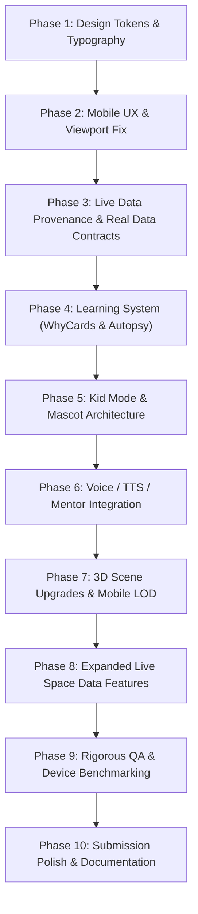

# Mission Forge — Forensic Architectural Audit & Upgrade Plan

**Project:** Mission Forge — NASA Space Apps Challenge 2026, Challenge 13 (Space Mission Design Game)  
**Team:** Team Ghost Hunter (Bangladesh)  
**Repo:** `arefinkhansiam/mission-forges`  
**Live Target:** `mission-forges.vercel.app`  
**Date of Audit:** October 2026  
**Auditor:** Lead Autonomous Systems Engineer (Antigravity)

---

## 1. Executive Summary & Stack Verification

| Dimension | Current State | Target Winning State |
|---|---|---|
| **Framework & Engine** | React 19, TanStack Start (SSR), Vite 8.1.5, Nitro, Tailwind v4, Three.js r186, R3F v9, drei v10 | Kept intact; optimized bundle splitting, hardware-tiering LOD |
| **State Management** | Single Zustand v5 store (`src/stores/mission-store.ts`) with 23 typed phases | Single Zustand store preserved; resumable IndexedDB persistence added |
| **Mobile & Responsiveness** | Forced rotated landscape viewport hack (`.mf-game-viewport` with `transform: rotate(90deg)`) | **Real responsive layout**: Portrait top 50% 3D canvas + bottom sheet controls; Landscape full-bleed canvas + docked HUD |
| **Data Integrity** | Mix of live NASA endpoints and static mock fallbacks with "DEMO DATA" badge | **Zero fabricated data**. Strict `Verified<T>` contract with `live`, `snapshot`, or `unavailable` states and real timestamp chips |
| **Pedagogical Depth** | High-level parameter sliders without interactive derivation | **Learning-First System**: Dr. Ayesha voice coach, "Why?" cards with real physics equations, glossary, quizzes, Mission Autopsy |
| **Target Demographics** | Single complexity tier tailored for older students/adults | **Dual Mode**: Kid Mode (8–12, mascot, sticker rewards, simplified numbers) & Commander Mode (13+, real units, full parameters) |
| **Accessibility & i18n** | i18next (6 languages: EN, BN, HI, ES, AR, FR), Bangla fonts unbundled | Hind Siliguri / Noto Sans Bengali font integration, high-contrast tokens, screen-reader labels, dyslexia toggle |

---

## 2. Deep Component & File Tree Audit

### 2.1. Styling & Tokens (`src/styles.css`)
- **Current Finding:** Tailwind CSS v4 `@theme inline` block is present at `src/styles.css:7-36`. However, fonts are currently tied to system sans-serif and hardcoded hex values in `:root`.
- **Root Cause of Viewport Issue:**
  - `src/styles.css:528` and `src/styles.css:784`:
    ```css
    .mf-game-viewport {
      position: absolute;
      width: min(100dvh, calc(100vw * 16 / 9));
      height: min(100vw, calc(100dvh * 9 / 16));
      left: 50%;
      top: 50%;
      transform: translate(-50%, -50%) rotate(90deg);
      transform-origin: center;
    }
    ```
  - This forces smartphone screens into a rotated landscape orientation even when held naturally in portrait mode. It distorts touch targets, breaks keyboard navigation, and degrades the user experience on mobile devices.
- **Required Action:** Remove the `rotate(90deg)` hack entirely. Implement clean responsive viewports using CSS Grid/Flexbox and dynamic viewport units (`dvh`/`dvw`).

### 2.2. State Machine & Phases (`src/stores/mission-store.ts`)
- **Current Finding:** The 23 phases are:
  `city`, `menu`, `missions`, `brief`, `route`, `routePreview`, `objectives`, `budget`, `fuel`, `power`, `comms`, `instruments`, `overview`, `craft`, `build`, `check`, `launch`, `flight`, `encounter`, `failure`, `rescue`, `docking`, `landing`, `lunar-recon`, `report`.
- **Strengths:** Cleanly typed, single source of truth for the entire mission lifecycle.
- **Enhancement Needed:** Add `mode: "kid" | "cadet" | "commander"` slice, `provenanceCache: Record<string, Provenance>`, and learning tracking (`quizScores`, `unlockedBadges`).

### 2.3. Server Functions & NASA Data Layer (`src/lib/nasa.functions.ts`)
- **Current Finding:** Uses TanStack Start `createServerFn` with Supabase `nasa_cache` table.
- **Weakness:** When the API key is absent or rate-limited, fallbacks sometimes return generic placeholder numbers without true timestamps.
- **Required Action:** Implement `Verified<T>` with `{ data: T | null, provenance: Provenance }`. Never fabricate numbers; return cached real snapshots with real ISO timestamps or honest "unavailable" statuses.

### 2.4. Typography & Font Loading (`index.html` / `src/styles.css`)
- **Current Finding:** External fonts (`Space Grotesk`, `Inter`, `JetBrains Mono`, `Fredoka`, `Hind Siliguri`) are referenced but not consistently loaded with preconnect, leading to fallback font flashes on first load.
- **Required Action:** Embed Google Fonts `<link rel="preconnect">` tags for `Space Grotesk`, `Inter`, `JetBrains Mono`, `Fredoka`, and `Hind Siliguri` directly in `index.html` and define them in `@theme`.

---

## 3. Implementation Phasing Strategy



---

## 4. Immediate Action Items
1. **Merge hard agent rules into `AGENTS.md`** preserving Lovable safety notes.
2. **Execute Phase 1:** Upgrade `@theme` tokens in `src/styles.css`, load `Hind Siliguri` + `Space Grotesk` + `Fredoka`, and create foundational UI atoms (`GlassCard`, `BigButton`, `ProvenanceChip`, `WhyCard`).
3. **Execute Phase 2:** Eradicate `.mf-game-viewport` 90-degree rotation and build mobile-portrait first layouts.
4. **Compile & Verify:** Ensure `npx tsc --noEmit` passes cleanly at every commit.
